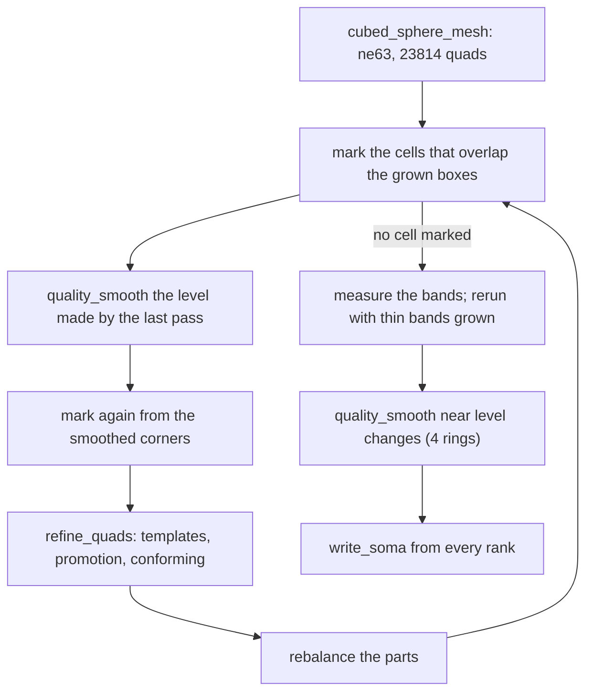

# A 200 m mesh of the contiguous United States

[`regional_refine`](../getting-started/examples.md#regional_refine) builds regionally refined
meshes (RRM) of the sphere, as E3SM runs on. This page follows one large run: the cubed sphere
ne63 refined to a 200 m grid spacing over the contiguous United States (CONUS), 50,226,202
quadrilaterals made, smoothed and written by 48 MPI ranks in under nine minutes. Every step is
parallel and the mesh stays conforming: all quads, no hanging vertices, five levels of
refinement joined by transition templates, then smoothed by optimization on each level as it is
made. The figures are drawn from the files the run wrote, read in parallel by SOMA's
[ParaView reader](../visualization/paraview.md).

```{figure} ../figures/img/conus-telescope.png
:alt: Six panels zooming in on one corner of a regionally refined mesh of the United States, coloured by refinement level from purple (coarsest) to yellow (finest): the whole refined region in stereographic projection, then windows 1200, 300, 75, 19 and 4.7 km high centred on its south-west corner, each outlined in the panel before it; cell edges appear in the last three panels, showing 200 m cells meeting larger transition cells
:width: 100%

From the whole refined region to the corner of the 200 m region (20.53 N, 124.63 W), each window 4 times smaller
than the last and outlined in the one before. Colours are refinement levels (mean cell size): 0, the ne63 cubed
sphere (47 km); 1 (9 km); 2 (3.2 km); 3 (1.0 km); 4 (355 m); 5 (196 m, 50.05M of the 50.2M cells). Each level is a
band a few cells wide (panels b and c), and each step between levels is one strip of transition cells (d to f).
```

## The run

```bash
mpiexec -n 48 ./regional_refine --ne 63 --km 0.2 --no-neighbours --format soma --max-cells 6e7 \
  --pass-optimize 50,5,10 --final-rings 4 --tolerance 1e-3 --area-ratio keep conus200m_p3
```

on one node of two Intel Xeon Gold 5317 processors (24 cores, 48 hardware threads), one thread a
rank (`OMP_NUM_THREADS=1`), in a Release build with MPICH and parallel HDF5. It prints:

```text
./regional_refine: passes 5; cells 23814 -> 50226202; radius 6.37122e+06
cells marked: 4103080
pass 1: 33662 cells, 0.18 s
  optimized: 50,1,10 sweeps, 10336 vertices free, least angle 30.46 -> 30.46, area ratio 4.538 -> 4.538 (bound 4.538), 2.12 s
pass 2: 103522 cells, 0.07 s
  optimized: 50,5,10 sweeps, 80196 vertices free, least angle 30.46 -> 30.46, area ratio 4.538 -> 4.538 (bound 4.538), 5.93 s
pass 3: 676898 cells, 0.25 s
  optimized: 50,5,10 sweeps, 653572 vertices free, least angle 30.46 -> 30.46, area ratio 4.596 -> 4.596 (bound 4.596), 37.24 s
pass 4: 5680942 cells, 2.12 s
  optimized: 50,5,10 sweeps, 5657616 vertices free, least angle 30.46 -> 30.46, area ratio 4.609 -> 4.609 (bound 4.609), 300.39 s
pass 5: 50226202 cells, 26.82 s
bands: 5 6 6 5
reruns: 0
spacing in the boxes: min 0.18 km, mean 0.19 km over 32735787 cells; outside: 0.18 to 52.95 km
mesh        min angle      mean < 45 deg   aspect  jacobian     area   min km  edge km
refined         30.46     84.19    28450    3.427     0.507    4.609    0.178    0.493  conus200m_p3_refined.soma
optimized       34.17     84.20    25578    3.310     0.533    4.609    0.178    0.493  conus200m_p3_optimized.soma
time (s) on 48 ranks: refine 46.78, pass optimize 345.69, smooth 0.00, optimize 79.97, total 516.12; peak memory 1080 MB a rank
finest cells' mean size: 0.59 km refined, +0.0% after smoothing
optimizer: 50,5,10 sweeps, 291888 vertices free, area ratio 4.609 -> 4.609 (bound 4.609)
```

The two meshes, `conus200m_p3_refined.soma` and `conus200m_p3_optimized.soma`, are SOMA files of
48 parts, 5.7 GB each, written by all 48 ranks at once. The run took 519.9 s of wall time and at
most 1.1 GB of memory a rank.

## How the mesh is made



**Marking and grading.** The mesh lives on the unit sphere, lengths measured as on the Earth.
The spacing of a cell is that of the GLL points of a spectral element of 4 points per edge,
$\sqrt{A}/3$ for a cell of area $A$, so ne63's elements, about 145 km across, are 47 km. A pass marks a cell
whose spacing is above 1.5 times `--km` and that overlaps one of the four CONUS boxes, grown so
that about three cells of each level lie between the next finer and the next coarser: a cell of
size $s$ that needs $k$ more passes is tested against the boxes grown by
$3 s (1/3 + \dots + 1/3^{k-1})$. Five passes take 47 km to the 0.18 to 0.19 km of the boxes.

**Conforming refinement.** [`refine_quads`](../algorithms/refinement.md#all-quad-conforming-refinement)
splits a marked cell into nine (each edge in three) and its neighbours into Schneiders'
transition templates by which of their corners are marked; a cell with two opposite or three
marked corners has no template and is promoted to a full split, repeated until no cell on any
rank changes. An edge's new vertices depend on its two ends only, so the cells on either side
split it alike and the mesh never has a hanging vertex. New vertices are projected onto the
sphere, and every child is checked to turn as its parent does. Then
[`rebalance`](../algorithms/refinement.md#rebalancing) evens the cells out over the ranks: pass 5
alone takes the mesh from 5.7 to 50.2 million cells.

**Smoothing each level as it is made** (`--pass-optimize 50,5,10`). Before a pass refines a level
the previous pass made, [`quality_smooth`](../algorithms/smoothing.md#optimization) optimizes it,
so the nine children of each cell copy a smoothed shape instead of the templates' sharp corners;
the vertices of cells still at level 0 stay put. The cells are then marked again from the moved
corners. The optimizer lowers each corner's condition number (Knupp) for 50 sweeps, raises the
least angle of the cells under 45 degrees for 5 (Freitag and Plassmann), and polishes the shape
for 10 more without letting the least angle fall. `--tolerance 1e-3` ends a phase once no vertex
moves farther than a thousandth of its shortest edge.

**Bands and reruns.** After the passes the band of each level is measured, in cells through
edges, from the cells next to a finer level to the nearest coarser cell. A band thinner than 3
cells, which promotion can cause, would be grown and the passes rerun; here the bands are 5, 6, 6
and 5 cells wide and no rerun is needed.

**The last optimization near level changes** (`--final-rings 4`). The mesh made by pass 5 is
optimized once more, moving only the 291,888 vertices within 4 cells of a level change: the
transition cells and their neighbours, where the worst angles are. The other 50 million cells are
uniform cells smoothed already as the level they were split from.

**The area ratio bound** (`--area-ratio keep`). The condition number does not see sizes, so the
optimizer can trade size for shape where two levels meet: the largest area ratio of two cells
sharing an edge grows. With a bound $R$, a step is kept only if no two cells sharing an edge, one
of them among the moving vertex's cells, are left with an area ratio above $R$ or above the largest
such ratio before the step, so the mesh's largest ratio never passes the larger of $R$ and its value
at the start. `keep` sets
$R$ to the largest ratio of the mesh being optimized (4.538 to 4.609 here). To keep the bound exact
in parallel, the mesh carries two ghost layers and vertices are coloured so that no two of a colour
lie in cells sharing an edge.

**Parallel and reproducible.** Each sweep moves one colour of vertices at a time (Jones and
Plassmann colouring, priorities hashed from gids), with a halo update after each, and sums each
patch in cell-gid order: the optimized mesh is the same bit for bit on any number of ranks and
threads. Gids, vertex positions and refinement levels are computed from the mesh alone, not from
the ranks, so refinement is too.

## Quality

```{figure} ../figures/img/conus-min-angle.png
:alt: The refined region in stereographic projection coloured by each cell's least angle, from dark purple at 72 degrees to pale yellow at 90; a smooth pattern of near-right angles inside the region, darker near the corners of the cube face it lies on, and cyan bands of cells under 72 degrees along the transitions between levels and in the coarse cells outside
:width: 100%

Each cell's least angle over the refined region. Inside the 200 m region the angles follow the cubed-sphere face,
near 90 degrees on its centre lines and about 74 near its corners; 99.9% of the 50.2 million cells are at or above
73 degrees. The cells under 72 degrees (cyan, 47,650) are the transition templates between levels and coarse cells
near the cube's edges.
```

```{figure} ../figures/img/conus-transition-zoom.png
:alt: A close-up of the corner of the 200 m region coloured by least angle: large cells on the left, a band of mid-sized cells and small cells on the upper right, joined by strips of transition cells drawn in cyan where their least angle is under 72 degrees
:width: 90%

The corner of the 200 m region, 39 km high: three levels and the transition templates between them, the only cells
under 72 degrees (cyan) here.
```

The bound has a cost. The same run without `--area-ratio keep` (`conus200m_p4`, every other
option the same) and the defaults of the commit before per-pass smoothing (`e311eb5`, one
optimization of the whole mesh at the end) give:

| run | cells | least angle | mean least angle | cells < 45 deg | jacobian | area ratio (refined to optimized) | optimize (s) | total (s) |
| --- | --- | --- | --- | --- | --- | --- | --- | --- |
| `e311eb5` defaults: one optimization at the end | 50336758 | 43.21 | 81.28 | 23929 | 0.622 | 4.554 to 11.136 | 2358.3 | 2498.9 |
| per level, rings 4 (p4) | 50335494 | 43.15 | 84.35 | 15078 | 0.652 | 6.268 to 6.955 | 357.0 | 453.9 |
| per level, rings 4, bound `keep` (p3) | 50226202 | 34.17 | 84.20 | 25578 | 0.533 | 4.609 to 4.609 | 425.7 | 516.1 |

Optimizing each level as it is made, and at the end only the cells near level changes (p4), is 5.5
times faster than one optimization of the finished mesh, raises the mean least angle and has 37% fewer
cells under 45 degrees. The bound holds the area ratio at the refined mesh's 4.609 but lowers the
least angle to 34.17 degrees: the worst angles are in transition templates, and opening them needs
the size change the bound forbids. Without it the largest area ratio is 6.955, 38% below the
single optimization's 11.136.

```{figure} ../figures/img/conus-p3-p4.png
:alt: Four close-ups of the same window at the edge of the 200 m region, two rows and two columns: the top row from the run with the area ratio bound, the bottom row from the run without it; the left column coloured by least angle from 30 to 90 degrees, mostly pale yellow with dark purple strips of transition cells; the right column coloured by area ratio from 1 to 7, mostly dark purple with teal strips where cells meet much smaller neighbours
:width: 100%

One window, 18.75 km high, at the edge of the 200 m region in p3 (top, with the bound) and p4 (bottom, without
it): least angle (left) and largest area ratio to an edge neighbour (right). The level changes coarser than
200 m fall in different places in the two meshes. Here the two look alike, transition cells with least angles in
the 40s and area ratios under 5; the extremes in the table lie elsewhere in the meshes.
```

## Looking at the mesh

The figures were drawn by ParaView's `pvbatch` on 16 MPI ranks, each reading its block of the
file's 48 parts through SOMA's [ParaView reader](../visualization/paraview.md), keeping the cells
of a spherical cap about the window and compositing the image with IceT. The 50 million cells
are read in about 10 s on 16 ranks; a figure of six panels takes about a minute and a half. The
views are stereographic projections about the finest level's mean direction $c$, with east $e$ and
north $n$ spanning the tangent plane there: a point $p$ maps to

$$
X = \frac{2\,(p \cdot e)}{|p| + p \cdot c}, \qquad Y = \frac{2\,(p \cdot n)}{|p| + p \cdot c},
$$

in units of the sphere's radius $R$. Lengths at an angle $\theta$ from $c$ are magnified by
$k = 2/(1 + \cos\theta)$, so a window of ground height $h$ there spans $h k / R$; the scale bars
use it. The scripts are in `tools/somaview/examples/conus/`:
`conus_prepass.py` (the quality statistics, the finest level's centre and the cells worth a
close-up, under `mpiexec` with the core reader), `level_spacing.py` (the size of each level),
`conus_stereo.py`, `conus_telescope.py` and `conus_compare.py` (the renders),
`conus_job.sh`, which runs all but the last, and `compose_conus.py`, which adds the titles, colour
bars, panel letters, scale bars and keys with matplotlib and cuts the figures to 256 colours for
these pages:

```bash
C=tools/somaview/examples/conus
PARAVIEW_BIN=/path/to/paraview/bin NP=16 $C/conus_job.sh conus200m_p3_optimized.soma out
mpiexec -n 16 pvbatch $C/conus_compare.py tools/somaview/paraview/SomaReader.py out/prepass.json \
  out/compare 9.375 p3=conus200m_p3_optimized.soma p4=conus200m_p4_optimized.soma
python $C/compose_conus.py stereo out figs
python $C/compose_conus.py telescope out figs conus200m_p3_optimized.soma
python $C/compose_conus.py compare out/compare figs
python $C/compose_conus.py docs figs docs/figures/img
```

See [visualization](../visualization/overview.md) for the readers themselves.
