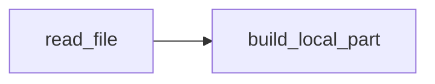

# Making figures

The figures of these pages are made from SOMA's own output, so a picture shows what the code
does: the program `soma_figure_data` runs SOMA and writes the data of each figure, and
`docs/figures/render.py`, run by ParaView's `pvpython`, draws the images into
`docs/figures/img/`. The images are committed, since Read the Docs and the wiki cannot run SOMA.
Diagrams of the design are Mermaid diagrams written in the pages themselves.

## What is needed

- A SOMA build configured with `-DSOMA_ENABLE_DOC_FIGURES=ON`, which needs `SOMA_ENABLE_MPI` and
  `SOMA_ENABLE_HDF5` (the data sets run on several ranks and read the meshes in `data/`).
- ParaView 6.1 for `pvpython`, which brings numpy and matplotlib. `make_figures.sh` uses the
  `pvpython` on `PATH`, else the one in a ParaView application under `/Applications`; set
  `PVPYTHON` to choose another.
- An MPI launcher: the build's `MPIEXEC_EXECUTABLE`, or `MPIEXEC`.
- bash 4 or newer.

## Making them

```bash
cmake -S . -B build -DCMAKE_PREFIX_PATH=/path/to/kokkos -DSOMA_ENABLE_MPI=ON \
  -DSOMA_ENABLE_HDF5=ON -DSOMA_ENABLE_DOC_FIGURES=ON
docs/figures/make_figures.sh build                  # every figure
docs/figures/make_figures.sh build box-mesh-gids    # only the figures named
```

`make_figures.sh` builds `soma_figure_data`, runs each data set the figures need at the rank
count the set declares, on one thread and with `--soma-reproducible`, into
`<build>/docs/figures/data/<set>/` (or `FIGURE_DATA`), then draws the figures and lists the
images that changed. It stops with a message naming what is missing when the build was not
configured for figures, `pvpython` or the launcher cannot be found, or a figure or set is unknown.

Regenerating a figure on the same machine gives the same bytes, so an image changes in git only
when its data or its drawing changed. Other machines, ParaView versions or graphics drivers may
render the PNG figures slightly differently; regenerate only the figures a change concerns.

With tests on, ctest makes every data set (`doc_figures.<set>`) and checks that
`soma_figure_data --list` matches the sets `docs/figures/CMakeLists.txt` registers
(`doc_figures.list`), so the sets keep working as SOMA changes.

## Adding a figure

1. **The data.** Add a set to the file of its area, `docs/figures/sets_<area>.cpp` (`concepts`,
   `parallel` or `algorithms`; the helpers they share are in `figure_data.hpp`): a function
   writing VTK files (meshes, with the fields the figure colours by, through `soma::write_file`)
   or JSON tables into its directory, registered in that file's `add_<area>_sets` with its rank
   count. A set's name is lowercase letters only. Check what the figure is about in the set
   (`require(...)`), so a change in SOMA that changes the picture fails the set rather than
   silently redrawing it. Add `<set>:<ranks>` to the area's `SOMA_FIGURE_SETS_<AREA>` list in
   `docs/figures/CMakeLists.txt`. Use the public API; only where it cannot give the data, add a
   small read-only accessor in `soma::detail` with its own unit test.
2. **The drawing.** Add a function to the area's `docs/figures/figures_<area>.py` with
   `@figure("<name>", ["<set>", ...], "png" | "svg")`; the helpers the modules share are in
   `figlib.py`. It reads `<data>/<set>/...` and writes the path it is given. Render meshes with ParaView (`pv_view`, `pv_surface`, `pv_color_by`,
   `pv_save`) as PNG, and draw schematics with matplotlib (`style.svg_figure`, `style.save_svg`)
   as SVG.
3. **The page.** Show it with a figure directive next to the text it explains:

   ````text
   ```{figure} ../figures/img/<name>.png
   :alt: What the image shows, for a reader who cannot see it
   :width: 70%

   The caption: what the figure shows and how to read it.
   ```
   ````

4. **Make it** with `make_figures.sh build <name>`, look at it, and check:
   `python3 docs/figures/check_figures.py` (ctest `docs.figures`), the Sphinx build with `-W`,
   and `python3 docs/wiki/build_wiki.py --check`.

## Style

`docs/figures/style.py` holds what every figure shares:

- a white background, so a figure reads the same in the site's light and dark themes and in the
  wiki (the site also puts Mermaid diagrams on white);
- categories such as ranks or ownership in the Okabe-Ito palette, which stays distinct for
  colour-blind readers; scalar fields in viridis, integer fields with one colour per value;
- PNG renders at 1400 by 1000 pixels, shown at about half that size; renders with smooth colour
  gradients (the algorithm figures' `save_png`) are cut to 256 colours with Pillow, which
  `pvpython` bundles, to stay within the size limit; SVG schematics with their text as outlines
  and no dates or ids that change between runs.

`docs.figures` fails when a figure's image is missing, a figure has no `:alt:` or no caption, an
image in `docs/figures/img/` is shown by no page, an image is over 300 KB, or the images together
are over 6 MB.

## Diagrams

Diagrams of the design (components, data flow, protocols) are written in the page as a plain
Mermaid fence:

````text

````

Sphinx draws it on the site (`sphinxcontrib-mermaid`), and GitHub draws the same fence in the
wiki. Name only functions and components that exist.
