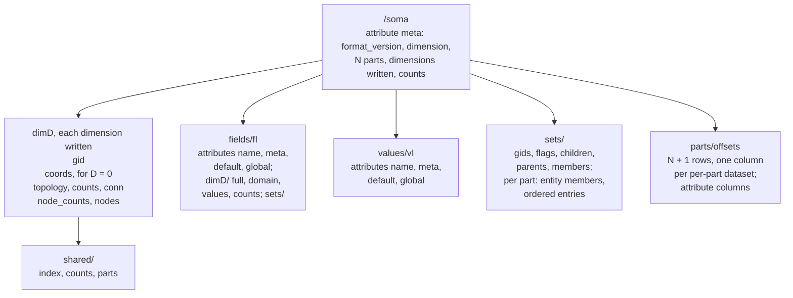

# The SOMA file format

The SOMA format is SOMA's own parallel mesh file, built on HDF5. Every rank
writes its part and every rank reads its share, with a fixed number of
collectives, and the file keeps everything a distributed mesh holds: parts,
sharing, fields, sets and mesh values. Use it for checkpoints and restarts and
for any large mesh; use [.h5m](h5m.md) or [VTK](vtk.md) to exchange meshes with
other tools. It needs a build with `SOMA_ENABLE_HDF5=ON`; without it the
functions below throw `std::runtime_error`.

## API

The header is `soma/io/soma_file.hpp`:

```cpp
void write_soma(const Comm& comm, const HostMesh& mesh, const std::filesystem::path& path,
                const SomaWriteOptions& options = {});
void write_soma(const HostMesh& mesh, const std::filesystem::path& path, const SomaWriteOptions& options = {});

HostMesh read_soma(const Comm& comm, const std::filesystem::path& path, const SomaReadOptions& options = {});
HostMesh read_soma(const std::filesystem::path& path, const SomaReadOptions& options = {});
```

The overloads without a `Comm` run on `Comm::self()`. Both functions with a
`Comm` are collective: call them on every rank, with the same options.

A restart, adapted from `tests/unit/test_soma_file.cpp`:

```cpp
const soma::Comm c = soma::Comm::world();
soma::write_soma(c, mesh, "restart.soma");               // every rank writes its part
// ... later, at the same or another rank count:
const soma::HostMesh back = soma::read_soma(c, "restart.soma");
```

Options are aggregates, so designated initialisers work, as in the tests:

```cpp
soma::write_soma(c, mesh, out, {.compression = 4});
soma::write_soma(c, mesh, full, {.derived = true});
const soma::HostMesh kept = soma::read_soma(c, out, {.rebalance = false});
```

`read_file` and `write_file` (see [Reading and writing meshes](overview.md))
call these for SOMA files and for paths ending in `.soma`.

## Write options

`SomaWriteOptions`:

| Name | Default | Meaning |
| --- | --- | --- |
| `compression` | `0` | Deflate level in [0, 9]. Above 0, datasets are chunked at about 1 MiB with the shuffle and deflate filters. |
| `derived` | `false` | Also write every dimension held on some rank (derived edges and faces with their gids and sharing), so that a read at the part count derives nothing and makes no gid directory pass. They are read back as derived. |
| `hints` | `{}` | MPI-IO hints and dataset alignment (`MpiIoHints`, below). |
| `aggregators` | `0` | 0: every rank writes its rows. M in [1, P]: rank r sends its rows to the first rank of its group floor(rM/P), and only those M ranks open the file and write, each its group's rows at once. M > 1 needs a parallel HDF5. The file is the same either way. |

## Read options

`SomaReadOptions`:

| Name | Default | Meaning |
| --- | --- | --- |
| `ordering` | `default_ordering` (`Ordering::type_major_sfc`) | The local ordering of the mesh built on each rank. |
| `rebalance` | `true` | When the file has fewer parts than ranks, migrate elements along the curve afterwards so that every rank gets some. |
| `adjacencies` | `true` | Build the adjacency graphs the writer's mesh held. |
| `hints` | `{}` | MPI-IO hints (`MpiIoHints`, below). |
| `aggregators` | `0` | 0: every rank opens the file and reads its rows. M in [1, P]: only the first rank of each group floor(rM/P) opens it, reads the metadata and its group's rows, and sends each rank its own. M > 1 needs a parallel HDF5. The mesh read is the same either way. |

## MPI-IO hints

`MpiIoHints` passes hints to collective file access by their ROMIO names. An
MPI library may ignore any of them. Unset fields leave the library's defaults,
and the file's content is the same as without hints.

| Name | Default | Meaning |
| --- | --- | --- |
| `cb_nodes` | `0` (unset) | Ranks MPI-IO aggregates through (`cb_nodes`). |
| `cb_buffer_size` | `0` (unset) | Bytes each aggregator handles at a time (`cb_buffer_size`). |
| `collective_buffering` | unset | Sets both `romio_cb_write` and `romio_cb_read` to `enable` or `disable`. |
| `striping_factor` | `0` (unset) | Number of stripes (Lustre's stripe count). |
| `striping_unit` | `0` (unset) | Stripe size in bytes. |
| `alignment` | `0` (none) | Datasets of at least this many bytes start on a multiple of it, so they begin on stripe boundaries. A power of two, or 0. Applies with a serial HDF5 too. |

The hints and the aggregator count must be the same on every rank. An
aggregator count outside [0, P], more than one aggregator with a serial HDF5,
a negative count among the hints, or an alignment that is not a power of two
throws `std::invalid_argument` on every rank, as does any difference between
the ranks' options.

From the tests (`AggregatorsAndHintsWriteTheSameFile`):

```cpp
soma::MpiIoHints hints;
hints.cb_nodes = 1;
hints.cb_buffer_size = std::size_t{1} << 20;
hints.collective_buffering = true;
hints.alignment = 4096;
soma::write_soma(c, m, out, {.hints = hints, .aggregators = a});
```

## What is written

A file holds N parts, where N is the size of the writing communicator: part p
is what rank p owned. For each part the file holds:

- per written dimension, the owned entities: gids, topology, corners and
  high-order nodes as gids, and coordinates for the vertices;
- for each owned shared entity, the parts holding copies of it;
- per field, its options (type, components, layout, tag format, whether it is
  variable-length or a handle field, its default and global values) and the
  part's values on its owned entities, with the members when the field's
  domain does not cover all of them; values on sets are written once;
- the sets, with each part's members (and, for ordered sets, their
  positions);
- the mesh values.

Ghosts and copies are not written: a mesh with a ghost layer writes the same
file as without it.

The dimensions written are the vertices, the mesh's dimension, every dimension
given to the builder on some rank, and every dimension a field has values on
or a set has members of. With `derived = true`, every dimension held on some
rank is written too. Other dimensions are derived again on read.

## Behaviour of `write_soma`

**Checked first, on every rank.** A mesh that cannot be written, a
compression level outside [0, 9], or sets, fields or mesh values that differ
between ranks throw `std::invalid_argument` on every rank before any file is
touched. The ranks compare hashes of their sets (gids, flags, children,
parents, the sets each contains) and of their fields and mesh values (apart
from values on entities) in one reduction.

**Whole or not at all.** Rank 0 creates a temporary file beside `path`
(`path` plus `.` and six random characters, created exclusively), the ranks
write it, and rank 0 renames it over `path`. A failure leaves no partial file
and does not damage an earlier file at `path`. I/O failures throw
`std::runtime_error` naming the path, on every rank.

**Edited meshes.** A mesh with edits (see [Editing meshes](../concepts/editing.md))
is written as its compressed copy on one rank; on more than one rank it throws
`std::logic_error` on every rank. Compress it first.

**How rows reach the file.** One exclusive scan places each part's rows in
every dataset. Then:

- with a parallel HDF5 and more than one rank, every rank opens the file with
  MPI-IO and writes its rows in one collective transfer;
- with `aggregators = M`, the M group leaders alone open the file and write
  their groups' rows, which are contiguous in every dataset;
- with a serial HDF5, each rank's rows go to rank 0 in turn, which writes
  them (the gathered, or streamed, sink).

The file is the same whichever path writes it. The same mesh at the same
rank count writes the same bytes through the serial path.

**Collectives.** The number of collectives does not grow with the number of
fields or ranks; `CollectivesDoNotGrowWithFieldsOrRanks` in
`tests/unit/test_soma_file.cpp` checks this.

## Behaviour of `read_soma`

At P ranks, a file of N parts is read with part q on rank floor(qP/N). Each
rank reads a contiguous block of parts when N ≥ P, and at most one when
N < P. Owners then send their shared entities, with their field values and set
memberships, to the ranks holding copies. The sharing comes from the file: no
gid directory is used to find it.

**Restart (N = P).** Each rank gets the part it wrote: the same owned
entities, the same sharing, and the same owned and shared segment boundaries.
With `derived = true` at write time, the derived edges and faces come back
with the same gids and sharing, and the read makes no gid directory pass.

**More parts than ranks (N > P).** Each rank reads a contiguous block of
parts and builds one local part from them.

**Fewer parts than ranks (N < P).** Ranks without a part read nothing; with
`rebalance` (the default) `read_soma` then migrates elements along the curve
so that every rank gets some. With `rebalance = false` they stay empty. A
file written on one rank and read on many is spread this way.

```{figure} ../figures/img/soma-read-parts.svg
:alt: Five copies of the Y-shaped mesh coloured by part or rank: a file of four parts and its read on two ranks; a file of two parts, its read on four ranks leaving ranks 1 and 3 empty, and its read with rebalance, where every rank holds cells
:width: 90%

`data/hybrid_3quad_1tri.h5m` written by `write_soma` on 4 ranks (top) and on 2 (bottom), coloured by the part
that wrote each cell, and read back: on 2 ranks, parts 0 and 1 go to rank 0 and parts 2 and 3 to rank 1; on 4
ranks with `rebalance = false`, part $q$ goes to rank $2q$ and ranks 1 and 3 stay empty; with `rebalance` (the
default), every rank gets cells.
```

**What comes back.** The result equals, by gid, the mesh written: entities,
coordinates, connectivity, high-order nodes, sets with their order, fields
with their domains, defaults, global values and formats, and mesh values.
With `adjacencies`, the graphs the writer's mesh held are built again (which
derives dimensions through the gid directory where they were not written).

**Errors.** A file that is not a SOMA file, a `format_version` newer than the
build reads, or datasets that disagree with the part table throw
`std::runtime_error` on every rank. A SOMA AMR checkpoint is refused with a
message naming `read_soma_amr`.

### One open, metadata read once

With a parallel HDF5 on more than one rank, the file is opened once,
collectively, with MPI-IO. Rank 0 alone reads the metadata (attributes,
dataset extents and where each dataset's rows are) and broadcasts it to the
others, in one broadcast of up to 64 KiB and a second for what does not fit.
Every rank then reads its rows straight from the file in one collective MPI-IO
read, for each dataset stored as it is read (contiguous and in the type read,
so not compressed and in the reader's byte order). Other datasets, such as
compressed ones or those in another byte order, are read through HDF5, which
converts them.

With a serial HDF5, each rank opens the file and reads its own rows. With
aggregators, only the group leaders open the file; each reads its group's
parts and sends every rank of the group its slice.

## File layout

Everything lives under the group `/soma`. The datasets of all parts are
concatenated in part order; the part table says where each part starts.



| Object | Content |
| --- | --- |
| `/soma` attribute `meta` | `format_version`, mesh dimension, number of parts N, bit masks of the dimensions written, given to the builder and holding high-order nodes, the adjacency graphs held, and the counts of sets, fields and mesh values, then the ordering |
| `/soma/dimD/gid` | gids of the owned entities of dimension D (i64) |
| `/soma/dim0/coords` | vertex coordinates (f64, 3 columns) |
| `/soma/dimD/topology`, `counts`, `conn` | for D > 0: topology code (u8), corner count (u32) and corners as vertex gids (i64) |
| `/soma/dimD/node_counts`, `nodes` | high-order nodes beyond the corners, where the dimension has them |
| `/soma/dimD/shared/index`, `counts`, `parts` | for each owned shared entity: its row, the number of parts holding copies, and those parts |
| `/soma/fields/fI` | field I: attributes `name`, `meta`, `default`, `global`; groups `dimD` (datasets `full`, `domain`, `values`, and `counts` for variable-length or non-`per_entity` fields) and `sets` for values on sets |
| `/soma/values/vI` | mesh value I: attributes `name`, `meta`, and `default` and `global` when present |
| `/soma/sets/...` | set gids, flags, children, parents and set members (written once), and per part the entity members and ordered entries |
| `/soma/parts/offsets` | the part table: N + 1 rows of u64, one column per per-part dataset; row p is where part p starts, the last row the totals. Its attribute `columns` names the datasets, one per line. |

Values are stored little-endian; the reader converts datasets in another byte
order. This layout is described for orientation: use `read_soma` to read a
file rather than relying on dataset names.

### Format version and compatibility

The current `format_version` is 1. A build reads files of its version or
older and refuses newer ones with `std::runtime_error`. HDF5 objects are
created in the HDF5 1.14 file format (the library's lower version bound is set
to 1.14), whatever newer HDF5 library writes them, so a newer library does
not raise the file format version the file needs. The reader does not depend on the rank
count, the HDF5 build (serial or parallel), the aggregators or the hints the
file was written with.

## Limits

- Needs HDF5 (`SOMA_ENABLE_HDF5=ON`); more than one aggregator needs a
  parallel HDF5.
- An edited mesh must be compressed before writing on more than one rank.
- The sets (gids, flags, children, parents, the sets each contains), and the
  fields and mesh values apart from their values on entities, must be the same
  on every rank.
