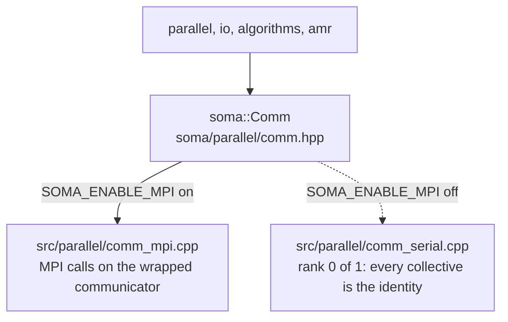

# Communicators

Every parallel operation in SOMA takes a `soma::Comm`, a thin, non-owning wrapper of an MPI
communicator. This page describes what it offers, how it behaves in a build without MPI, and
how errors are reported. Use it directly when your own code needs a reduction, a broadcast or a
point-to-point message alongside SOMA's algorithms.

## One seam for serial and MPI builds

`soma::Comm` is declared in `soma/parallel/comm.hpp`. It is the single place where SOMA
distinguishes the two builds: algorithms call its collectives unconditionally, and in a build
configured without MPI (`SOMA_ENABLE_MPI` off) every call is the single-rank identity, rank 0 of
1. The data model and every algorithm are therefore the same in both builds; a serial run is a
one-rank parallel run.



```cpp
class Comm {
 public:
  static Comm world();
  static Comm self();

  [[nodiscard]] int rank() const noexcept;
  [[nodiscard]] int size() const noexcept;
  // ...
#if SOMA_ENABLE_MPI
  explicit Comm(MPI_Comm comm);
  [[nodiscard]] MPI_Comm native() const noexcept;
#endif
};
```

- `Comm::world()` wraps `MPI_COMM_WORLD`; `Comm::self()` wraps `MPI_COMM_SELF` (rank 0 of 1 in
  every build). Pass `Comm::self()` to run a collective algorithm on one rank's data alone, as the
  single-rank merge does (see [matching and merging](matching-and-merging.md)).
- In an MPI build, `Comm(MPI_Comm)` wraps a communicator of your own and `native()` returns the
  wrapped handle, for calling MPI or another library directly. Both exist only when
  `SOMA_ENABLE_MPI` is 1, so guard such code with `#if SOMA_ENABLE_MPI` (from `soma/config.hpp`).
- A `Comm` is non-owning: it never frees the communicator it wraps, which must outlive every
  copy of the `Comm`. Copies are cheap.
- Constructing a `Comm` before MPI is initialised throws `std::runtime_error`. Create a
  `soma::ScopeGuard` (`soma/runtime/scope_guard.hpp`) first; it initialises MPI (with
  `MPI_THREAD_FUNNELED`, unless MPI is already initialised) and Kokkos, and finalises what it
  initialised. See [runtime and options](../concepts/runtime.md).

A minimal program, after `examples/laplacian_smooth.cpp`:

```cpp
#include <cstdint>
#include <cstdio>

#include "soma/parallel/comm.hpp"
#include "soma/runtime/scope_guard.hpp"

int main(int argc, char** argv) {
  const soma::ScopeGuard guard(argc, argv);
  const soma::Comm comm = soma::Comm::world();
  const std::int64_t total = comm.allreduce(std::int64_t{1}, soma::Op::sum);
  if (comm.rank() == 0) std::printf("%lld ranks\n", static_cast<long long>(total));
}
```

## Collectives

Every member below is collective over the communicator: call it on every rank, in the same
order.

| Member | What it does |
|---|---|
| `barrier()` | Waits for every rank. |
| `allreduce(T value, Op op)` | The reduction of one value, returned on every rank. |
| `allreduce(std::span<T> values, Op op)` | Element-wise reduction of a span, in place. |
| `exscan(T value)` | Exclusive prefix sum; rank 0 receives `T{}`. |
| `exscan(std::span<T> values)` | Exclusive prefix sums of each entry, in place, in one call. |
| `bcast(std::span<T> buffer, int root)` | Broadcast from `root`; `T` trivially copyable. |
| `alltoall(send, recv)` | Block `r` of `send` (`send.size() / size()` elements) to rank `r`. |
| `alltoallv(send, send_counts, recv, recv_counts)` | Variable counts per rank, contiguous in rank order. |
| `allgatherv(mine, counts = nullptr)` | Every rank's `mine`, concatenated in rank order, on every rank; optionally how many each gave. |
| `split(int color, int key)` | A new communicator per color (see below). |
| `ibarrier()` | Non-blocking barrier: the returned `Request` completes once every rank has called it. |

`alltoall`, `alltoallv`, `bcast` and `allgatherv` take any trivially copyable `T` (a
`static_assert` checks it); each has an untyped `*_bytes` primitive behind it.
`alltoall` throws `std::invalid_argument` unless both buffers are the same whole number of blocks
per rank; `alltoallv` throws it unless there is one count per rank and the counts add up to the
buffer sizes.

### Reductions and types

```cpp
enum class Op : std::uint8_t { sum, min, max, prod };
```

`allreduce` and `exscan` are defined for `std::int32_t`, `std::int64_t`, `std::uint64_t` and
`double`; other types fail to link. Sums of `double` through `allreduce` follow MPI's reduction
order, which may change with the number of ranks; for sums that are the same bit for bit on any
number of ranks and threads, use [reproducible sums](reproducible-sums.md).

### Splitting

```cpp
[[nodiscard]] SplitComm split(int color, int key) const;
```

One collective: the ranks giving the same color form a group, ordered by `key` then rank. A
negative color joins no group. The result is a `SplitComm`, which owns the new communicator and
frees it when destroyed (move-only). `member()` is false on a rank that gave a negative color;
`comm()` returns the group's `Comm` and throws `std::logic_error` on a non-member. Without MPI the
one rank is its own group.

## Point-to-point messages

```cpp
static constexpr int any_source = -1;
[[nodiscard]] Request isend_bytes(std::span<const std::byte> buffer, int dest, int tag) const;
[[nodiscard]] Request issend_bytes(std::span<const std::byte> buffer, int dest, int tag) const;
[[nodiscard]] Request irecv_bytes(std::span<std::byte> buffer, int source, int tag) const;
[[nodiscard]] std::optional<Envelope> iprobe(int source, int tag) const;
```

with typed `isend`, `issend` and `irecv` templates over trivially copyable `T`.

- The buffer must stay valid, and a receive buffer untouched, until the request completes.
  `isend` may complete before the message is received, `issend` only once it is.
- A message longer than the receive buffer is an error.
- Tags must be in $[0, 32767]$, the least MPI guarantees; a tag outside it, or a rank outside the
  communicator, throws `std::invalid_argument`.
- `iprobe` reports the next message from `source` (or `any_source`) with `tag`, if one has
  arrived, as an `Envelope` (`source`, `tag`, `bytes`); the message stays queued until received.
- Without MPI, rank 0 sends to itself through a queue matched by tag, in send order.

A `Request` is move-only. `test()` reports completion, `wait()` blocks, and
`Request::wait_all(std::span<Request>)` waits for several. A default-constructed or finished
request is complete, and destroying an unfinished request waits for it.

`next_sequence()` returns and advances a count kept per communicator (not per `Comm` object):
ranks that call it equally often agree on its value, which lets successive exchanges of your own
use different tags.

SOMA's own exchanges use high tags of the communicator: `transport::route` uses tags 32000 to
32767, communication plans 32600 and 32601, and halo exchanges 32610 and 32611. Avoid those for
messages that may be in flight at the same time as a SOMA exchange.

## Errors

- In an MPI build, an MPI call that returns an error code throws `std::runtime_error` naming the
  call and MPI's error string. Under MPI's default error handler (`MPI_ERRORS_ARE_FATAL`) MPI
  aborts before returning an error, so this applies when the communicator's handler returns
  errors.
- A message of more than `INT_MAX` elements throws `std::length_error`.
- Argument errors (`alltoall` and `alltoallv` sizes, ranks and tags of point-to-point calls)
  throw `std::invalid_argument` on the rank that made them; they are not agreed across ranks.
- Without MPI, waiting for a message nothing sends throws `std::logic_error` (it would wait
  forever), and a message longer than its receive buffer throws `std::runtime_error`.

SOMA's higher-level collective operations (building a distributed mesh, ghosts, merging,
transport) check their inputs with a reduction and throw on every rank when any rank's input is
invalid, so a failure does not leave other ranks waiting in a collective. Their pages say which
exceptions are thrown.

## GPU-aware MPI

The CMake option `SOMA_GPU_AWARE_MPI` (`AUTO`, `ON` or `OFF`; default `AUTO`) records whether
device buffers may be passed to MPI. `AUTO` resolves to `ON` when MPI is enabled and Kokkos has a
GPU backend, otherwise `OFF`; `ON` without `SOMA_ENABLE_MPI` is a configuration error. The
resolved value is written to `soma/config.hpp` as `SOMA_GPU_AWARE_MPI_DEFAULT` (0 or 1) and shown
in the configure summary.

```{note}
The current exchanges do not pass device buffers to MPI whatever this setting:
[halo exchanges](ghosts-and-halos.md) and [record transport](transport.md) stage their messages
through host memory, one copy in and one out.
```

## Counting collectives

For tests, `soma::detail::comm_counts()` returns how many collective calls of `Comm` (`barrier`,
`allreduce`, `exscan`, `bcast`, `alltoall`, `alltoallv`, `ibarrier`) and how many
`transport::route` calls this process has made. SOMA's tests use it to check how many
collectives an operation makes (for example, that `allreduce_exact` is one). It is in the
`detail` namespace and not a stable interface.
