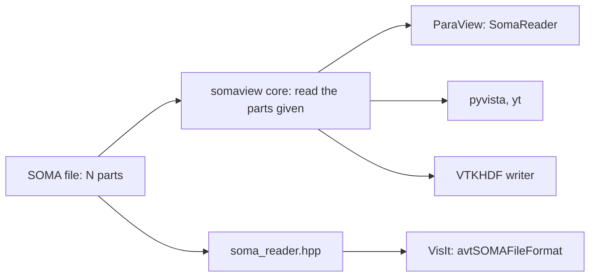

# Visualizing SOMA files

SOMA files can be opened directly in ParaView, VisIt, pyvista and yt, with no conversion step:
`tools/somaview/` holds readers for each, and an exporter to VTKHDF for
any other VTK-based tool. All of them read a SOMA mesh file (see [the SOMA format](../io/soma-format.md))
or an AMR checkpoint (see [AMR checkpoints](../io/amr-checkpoints.md)) part by part, so a file
written by thousands of ranks is read by as many or as few processes as a viewer runs on, each
reading only its own parts.

| Tool | Reader | Parallelism |
| --- | --- | --- |
| [ParaView](paraview.md) | `paraview/SomaReader.py`, a Python reader plugin | pvserver and pvbatch pieces, a block of parts each; IceT compositing |
| [VisIt](visit.md) | `visit/`, a C++ database plugin over `soma_reader.hpp` | domains are parts, spread over the engine's ranks by VisIt |
| [pyvista and yt](python.md) | `somaview.plot`, `somaview.read_pyvista`, `somaview.yt.load` | one process, any subset of parts |
| [VTKHDF](python.md#vtkhdf-files) | `somaview.write_vtkhdf`, `somaview convert` | one partition per part; a collective MPI-IO write with `comm=` |

## One reading core

The Python package `somaview` (`tools/somaview/src/somaview/`, needing only numpy and h5py) reads
the file's layout (the part table, fields, sets and mesh values) and builds, for any subset of the
parts, the points, cells and fields of that subset in VTK's terms. ParaView's reader and the
pyvista and yt front-ends are thin layers over it; VisIt's plugin is C++ over
`soma_reader.hpp`, a header-only reader on the HDF5 C API that does the same and is tested
against it.



### Reading a subset of parts

Part $p$ of a file is what rank $p$ owned when it was written, and it stores only the vertices it
owns; its cells also use vertices other parts own, its halo. The file records which parts hold
copies of each shared vertex (`dim0/shared`), and the readers find the halo of the parts they read
in one of two ways:

- **Scan** (the default): read the other parts' sharing tables in bounded chunks and keep the
  rows whose copies are on the parts being read. No communication: any process can read any part
  on its own, as a VisIt domain or a notebook looking at one part does.
- **Exchange** (`comm=`, an mpi4py communicator): each rank reads only its own parts' sharing
  tables and sends its owned shared vertices, with their point fields, to the ranks holding
  copies, in one all-to-all, as SOMA's own reader does. A rank's I/O and memory are then
  proportional to its parts and their interface.

At $P$ processes part $q$ goes to process $\lfloor qP/N \rfloor$, SOMA's own rule, so each
reads a contiguous block of parts with one hyperslab per dataset.

```python
import somaview as sv

piece = sv.read("mesh.soma")                          # every part, merged by gid
piece = sv.read("mesh.soma", parts=[3, 4], point_fields=["T"])
from mpi4py import MPI
piece = sv.read("mesh.soma", comm=MPI.COMM_WORLD)     # under mpiexec: each rank its parts
```

### What is drawn

- The cells of the mesh's dimension by default, the lower dimensions it wrote (boundary faces,
  edges) on request.
- Linear cells in VTK's corner order. VTK 9.7 changed the corner order of `vtkWedge`: a SOMA
  (MOAB) prism, its base counterclockwise seen from its top, is a positive wedge as stored in VTK
  9.7 and later and needs its corners reordered [0 2 1 3 5 4] in VTK 9.6 and earlier (ParaView
  6.1, VisIt 3.5). The readers pick by the VTK in use; `SOMAVIEW_VTK_WEDGE=legacy` or `current`
  overrides.
- High-order elements as VTK's quadratic cells (edge3, tri6, tri7, quad8, quad9, tet10,
  pyramid13, prism15, hex20, hex27), their edge and face nodes put in VTK's order.
- Polygons as VTK polygons; knives as VTK polyhedra (in VisIt, degenerate hexahedra); SOMA
  polyhedra, stored by vertices only, as convex point sets.
- Fields with one fixed-size row per entity: point data on vertices, cell data on cells, NaN off a
  field's domain. Fields on entity sets become cell labels `set:<name>`. `soma_part` is the part
  owning each cell and `soma_gid` the global ids (also VTK's GlobalIds).
- AMR checkpoints: one grid per box, the coarse cells under finer boxes blanked.

```{note}
SOMA's own VTK output (see [VTK output](../io/vtk.md)) writes prisms in stored order, which VTK 9.6
and earlier read as inverted wedges (negative volumes). The readers here do not have this problem.
```

## Installing

```bash
pip install -e tools/somaview[all]     # numpy, h5py, plus pyvista, vtk, yt, mpi4py
pip install -e tools/somaview          # the core only
```

For distributed reading install mpi4py and an h5py built against parallel HDF5
(`h5py.get_config().mpi`). ParaView's plugin and VisIt's plugin are installed in those tools; see
their pages.

## Testing

The tests read files SOMA itself writes. `tools/somaview/tests/make_data.sh` makes them with an
installed SOMA (built with HDF5; with MPI, also files written by 4 and 7 ranks), through the
CMake project `tools/somaview/tests/gen/`, which is built as
[an application outside SOMA's tree](../getting-started/examples.md#an-application-outside-somas-tree) is:

```bash
cmake --install build --prefix $HOME/soma
tools/somaview/tests/make_data.sh $HOME/soma           # writes tools/somaview/tests/data/
python -m pytest tools/somaview/tests
```

The suites check the readers against SOMA's own reader (run in a separate process when
`SOMAVIEW_SOMA_PYTHON` names a SOMA build's `python/` directory): coordinates, cell corners and
every field by gid, the outward normals of every linear 3D cell and a positive volume for every
quadratic cell in the VTK in use, set labels, every part read alone, the exchange path and VTKHDF
round trips. `tools/somaview/tests/mpi/validate_mpi.sh` runs the distributed checks: every file
read under `mpiexec` at 1 to 8 ranks by both halo methods, the collective VTKHDF write, ParaView's
pvbatch pieces and a large file at up to 48 ranks.

## Scale

On one node of two Intel Xeon Gold 5317 processors, a 48-part SOMA file of the
[200 m CONUS mesh](../apps/conus-200m.md) family (50,304,352 quadrilaterals) reads as follows,
each rank one thread:

| Ranks | Exchange (s) | Scan (s) | Peak memory a rank |
| --- | --- | --- | --- |
| 8 | 9.51 | 8.37 | not measured |
| 16 | 5.90 | 4.75 | not measured |
| 24 | 3.77 | 3.20 | 905 MiB |
| 48 | 2.91 | 2.49 | 502 MiB |

One part alone, 1,048,007 cells and its halo, reads in 1.08 s in one process. VisIt reads the
same file on an 8-rank engine, and ParaView renders the 50,226,202-cell mesh of that page on 16
ranks.
